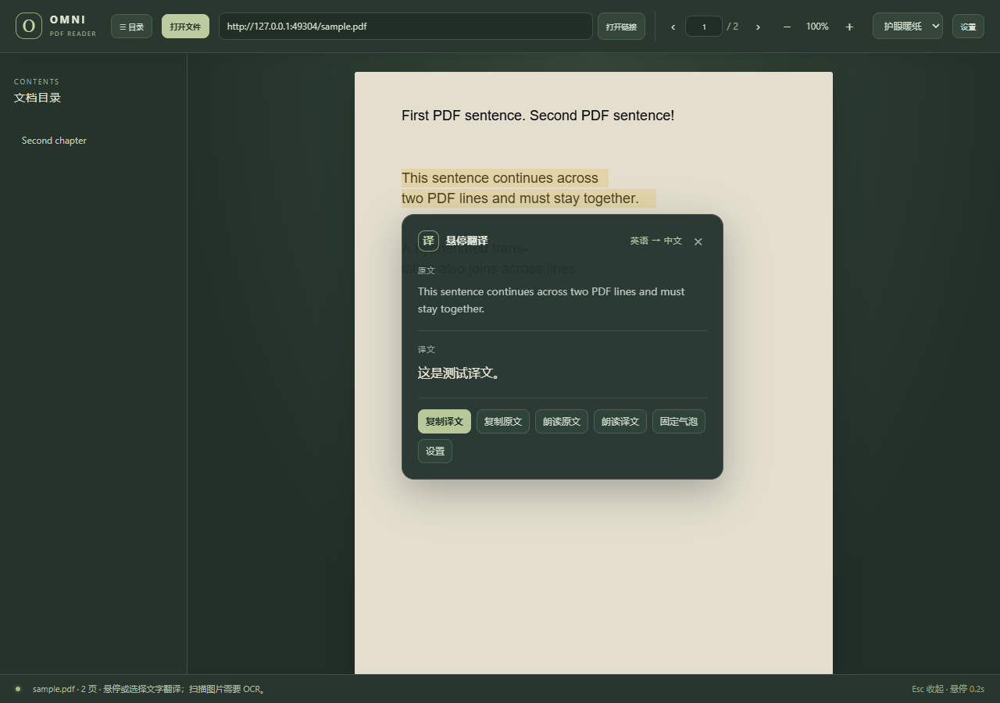

# Omni Hover Translator

在网页和 PDF 上悬停翻译，也能用键盘逐句阅读。面向 Microsoft Edge / Chrome 的 Manifest V3 扩展。

**当前版本：1.3.1。普通用户无需安装 Node.js。需要自己的 DeepL API Key 或可用的 LibreTranslate 服务。当前未上架 Edge 扩展商店，采用“加载解压缩的扩展”安装。**



## 在 Edge 安装

1. 打开本仓库的 **Releases**，下载附件 `Omni-Hover-Translator-1.3.1-Edge.zip`。解压到准备长期保留的文件夹，例如 `D:\Apps\OmniHoverTranslator`。
2. 在 Edge **地址栏**输入 `edge://extensions` 并回车。开启左侧或页面上的 **开发人员模式**；窗口太窄时先展开左上角菜单。
3. 点击 **加载解压缩的扩展 / 加载已解压的扩展程序**，选择解压后**直接包含 `manifest.json` 的文件夹**，不要选择 ZIP 文件。
4. 点击工具栏的扩展图标，在 Omni 旁选择“在工具栏中显示”。打开 Omni → **完整设置**，按下节配置翻译服务。
5. 刷新安装前已打开的网页，悬停在文字上即可使用。

**也可以从绿色 Code → Download ZIP 下载整个仓库**：解压后选择其中的 **`dist`** 文件夹。仓库根目录和 `extension` 文件夹不用于直接安装；`extension` 是开发源码，PDF.js 资源在 `dist/vendor` 中。

需要 Edge / Chrome **150 或更新版本**；版本较旧时请先更新浏览器。Chrome 的对应安装入口是 `chrome://extensions`。

[详细安装、升级与排障](docs/EDGE_INSTALL.md)

## 第一次配置

点击 Omni 图标 → **完整设置** → **语言与翻译服务**。

| 服务 | 如何配置 |
| --- | --- |
| DeepL API Free | 选择 Free，填写自己的 DeepL API Key；申请入口：[DeepL API](https://www.deepl.com/pro-api) |
| DeepL API Pro | 选择 Pro，填写对应 API 套餐的 Key；普通翻译网站会员与 API 套餐不同 |
| LibreTranslate | 填写完整的 `/translate` 服务地址，以及该服务要求的 Key；支持 HTTPS 和本机 localhost / 127.0.0.1 的 HTTP |

默认英语 → 中文，可选择其他源语言、目标语言或自动检测。修改会自动保存；点击 **保存并测试连接** 确认服务可用。此扩展不提供共享 Key 或免费公共翻译接口，翻译额度与费用由所选服务决定。目前不支持填写 OpenAI Key。

## 怎么使用

| 场景 | 操作 |
| --- | --- |
| 网页翻译 | 鼠标停在文字上，默认 0.2 秒触发；支持跨行句子和划词翻译 |
| 关闭气泡 | 悬停气泡移出后自动收起；`Esc` 随时关闭。手动固定或划词气泡需要取消固定 / 关闭 |
| 不动鼠标读论文 | 设置 → 阅读与朗读 → 开启“键盘逐句阅读”；`Alt+J` 下一句，`Alt+K` 上一句；自动将当前句子滚入视野，输入框内不会触发 |
| 从键盘切回鼠标 | 实际移动鼠标后恢复悬停，移出后按设置延时收起；只用键盘时气泡保留供阅读，下一句会替换当前气泡 |
| PDF 翻译 | 默认接管 HTTP(S) `.pdf` 链接；也可 Omni → PDF 阅读器 → 打开文件 / 打开链接。翻译需要在 **Omni 阅读器** 中进行 |
| 无 `.pdf` 后缀的链接 | 右键链接 → 使用 Omni PDF 阅读器打开链接，或在阅读器粘贴 URL |
| 本地 PDF | 从 Omni 阅读器的“打开文件”选择 PDF，不需要开启浏览器的本地文件访问权限 |
| 暂停翻译 | 工具栏开关，或 `Alt+Shift+T`；如果快捷键冲突，在 `edge://extensions/shortcuts` 中调整总开关快捷键 |
| 气泡大小 | 气泡右上角或完整设置中选小 / 中 / 大；还可微调宽度、字号、不透明度、配色和高亮 |
| 快捷翻译 | 打开工具栏面板粘贴文字，复制译文、朗读，或查看可选的本地历史 |

PDF 阅读器支持连续滚动、缩放、页码跳转、目录、暖纸 / 夜读 / 原色。网页与 PDF 共用语言、触发延时、气泡和高亮偏好。

## 更新版本

使用同一个文件夹覆盖旧文件，在 `edge://extensions` 找到 Omni，点击 **重新加载 / 刷新图标**，然后刷新已打开的网页和 PDF。仅修改设置不需要重新加载。

**不要删除或移动已加载的扩展文件夹；不要通过移除重装来更新。** 沿用原文件夹和浏览器配置可保留已有设置、Key 和历史。

## 常见问题

- **下载后无法安装 / 提示缺少清单**：选错了目录。选择直接含 `manifest.json` 的文件夹；仓库 ZIP 要选 `dist`，Release 安装 ZIP 要选解压出的扩展文件夹。
- **只有“扩展”，没有开发人员模式**：先确认地址栏确实是 `edge://extensions`，展开页面菜单。受组织管理的浏览器若禁用了开发人员模式，需要管理员允许。
- **设置保存后没有变化**：升级文件后先重新加载扩展，再刷新旧网页 / PDF；从 Omni 图标打开设置，不要双击 `options.html`。
- **PDF 无法悬停**：浏览器自带 PDF 页不能直接注入翻译。请在 Omni 阅读器里打开；扫描图片 PDF 没有文字层，本版未提供 OCR。
- **只高亮，不出译文 / 服务报错**：使用“保存并测试连接”检查 Key、Free / Pro 选择、地址、网络和服务额度。
- **快捷键没反应**：确认逐句阅读开关已开启、翻译未暂停、当前焦点在文档且不在输入框。网站或其他扩展可能使用同一组快捷键，无法保证所有站点都没有冲突。
- **登录链接、复杂双栏论文**：远程读取受登录或防盗链影响时先下载后打开；复杂 PDF 的阅读顺序取决于文档文字层，必要时使用手动划词。

## 隐私与权限

Key 只保存在本机扩展存储中，未加密、不云同步，不随此项目分发。翻译的当前文字会发送到你配置的服务；普通网页翻译不会上传整页，PDF 阅读器会读取你打开的 PDF 来渲染。历史记录默认关闭。全站 HTTP(S) 权限用于网页文字捕获、PDF 获取、PDF 链接重定向和翻译服务请求。详见 [隐私说明](docs/PRIVACY.md)。

## 开发与发布

需要 Node.js 24+。Windows PowerShell 使用 `npm.cmd` / `npx.cmd`，其他系统可用 `npm` / `npx`。

```powershell
npm.cmd ci
npm.cmd run build
npm.cmd test
npx.cmd playwright install chromium
npm.cmd run test:browser
npm.cmd run package
```

- `extension/`：源码；`shared/TranslatorCore.js` 复用分句、高亮、气泡和键盘阅读。
- `dist/`：已构建、可直接加载；本仓库有意保留它，供下载源码 ZIP 的普通用户安装。
- `scripts/`：构建、安装包和 GitHub 目录整理脚本。
- `tests/`：单元与真实浏览器回归；翻译接口在测试中模拟，不需要真实 Key。
- `docs/`：安装、隐私、架构、GitHub 上传和 Release 说明。
- `.github/workflows/`：持续集成；推送 `v*` 标签时自动生成 Release 与 Edge 安装附件。

`npm.cmd run package` 在 `release-assets` 中生成含本地 PDF.js 的安装 ZIP。修改源码后应重新构建并提交 `dist`。

准备首次上传时运行 `npm.cmd run prepare:github`，会在本地生成独立的 `github-upload` 目录；只复制发布所需文件，不包含历史交付包、`node_modules` 或测试输出。

维护者上传步骤：[发布到 GitHub](docs/GITHUB_PUBLISH.md)。实现说明：[架构文档](docs/ARCHITECTURE.md)；版本记录：[CHANGELOG](CHANGELOG.md)；第三方组件：[THIRD_PARTY_NOTICES](THIRD_PARTY_NOTICES.md)。
